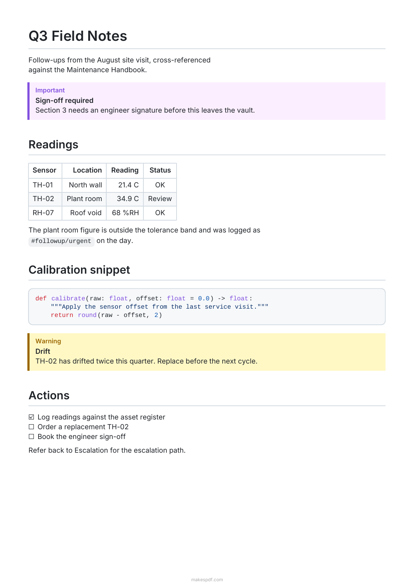
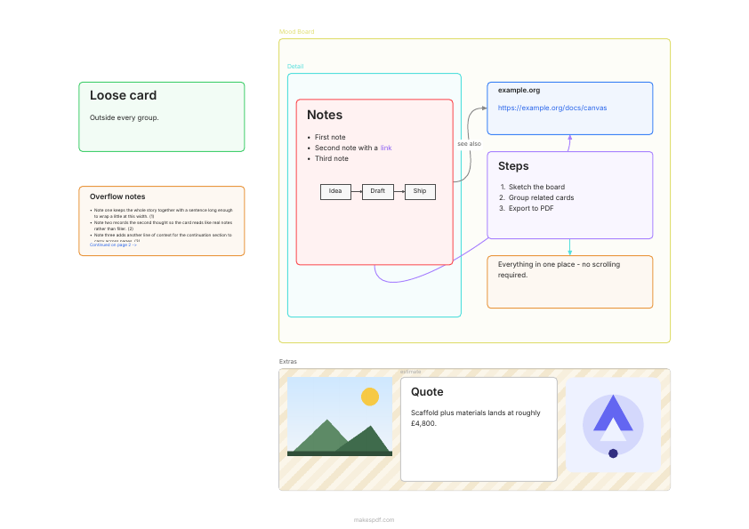

# MakesPDF

Export an Obsidian note or canvas board to a typeset, accessible PDF using
the [makespdf.com](https://makespdf.com?ref=obsidian) API.

Obsidian's built-in export prints the rendered view. This plugin sends the note's
markdown to a layout service that produces a tagged PDF: real heading structure,
alt text on figures, table headers, and reading order. Output is
PDF/A-2A + PDF/UA-1 compliant, which is what accessibility and archival
requirements generally ask for.



*A note containing callouts, wikilinks, a table, a code block, and task items,
exported with the default settings.*

## Network use and privacy

**This plugin sends note content to a remote server.** It cannot work offline.

- When you run an export, the note's markdown is POSTed to
  `https://makespdf.com/api/v1/md` and the resulting PDF is written back into
  your vault. The request identifies the plugin and its version in the
  `X-MakesPDF-Client` header.
- Embedded local images are read from your vault and inlined into that same
  request. Embedded notes (`![[note]]`) are inlined too, so their contents are
  sent as well.
- A canvas export POSTs the board's JSON to
  `https://makespdf.com/api/v1/canvas`, together with the contents of the
  files the board references: images and group backgrounds are inlined as
  data, PDFs are sent as file data so their pages can be embedded, and
  linked notes are sent as markdown. The same identification header
  applies.
- **Feedback is sent only when you send it.** **Send feedback** (command and
  settings button) and the **Report problem** link on an export error POST to
  `https://makespdf.com/api/v1/feedback` (on your configured API URL). A
  feedback request contains the message you type, the kind you picked
  (problem, idea or praise), the plugin name and version, and your API key if
  one is set, so the feedback is linked to your account. Without a key, or if
  the server rejects it, feedback is sent anonymously. **Report problem** also
  sends a few facts about the failed export: the HTTP status, the server's
  error code if it returned one, your page size setting, and the size in bytes
  of the export request (the note plus any embedded notes and inlined images).
  Feedback never includes the note's text, its path, or your vault name. The
  service stores your message with a daily-salted hash of your IP address and
  your country code, and keeps it until the makesPDF team deletes it. Your IP
  address is also used, unhashed, for rate limiting. Please don't paste note
  content into the message.
- Nothing else is transmitted. No analytics or telemetry are collected by the
  plugin.
- The endpoint you talk to is configurable. Point **API URL** at your own
  deployment if you do not want to use the hosted service.
- Uploaded source and rendered output are retained by the service for 7 days so
  you can re-download them, then deleted. See the
  [makespdf.com privacy policy](https://makespdf.com/legal/privacy?ref=obsidian).

## Account and cost

No account is required. Without an API key the plugin uses a free anonymous
path, which is rate limited by IP (60/hour, 200/day) and capped at 20 pages per
export.

Adding an API key from a [makespdf.com](https://makespdf.com?ref=obsidian)
account raises those limits and removes the page cap. Exports made with a key
draw on that account's render credits (1 credit per 10 pages), less any free
page allowance currently in effect.

## Usage

- **Command palette:** "Export current note to PDF" for a Markdown note, or
  "Export current canvas to PDF" when a `.canvas` board is active
- **Ribbon icon:** the PDF export button in the left sidebar, which exports
  the active note or canvas

The PDF is written into your vault, next to the source file, or into the folder
set in **Output folder**. Re-exporting overwrites the previous file.

Output paths are relative to the vault root. PDFs are created through Obsidian's
vault API, so they cannot be written outside the vault: a path like
`~/Downloads` is not expanded and is rejected rather than creating a folder
named `~` in your vault.

### What gets converted

Obsidian-specific syntax is translated to GitHub Flavored Markdown before
export:

| Obsidian | Becomes |
|---|---|
| `[[Page]]`, `[[Page\|Alias]]` | plain text (`Page`, `Alias`) |
| `![[note]]`, `![[note#Heading]]` | the referenced content, inlined (max 3 levels deep) |
| `![[image.png\|400]]` | a sized image |
| `==highlight==` | `<mark>`, painted as a highlight |
| `%%comment%%` | removed |
| `#tag`, `#nested/tag` | inline code |
| `> [!tip]`, `> [!danger]` and other callouts | the closest GFM alert |
| trailing `^block-id` | removed |

Code blocks are syntax highlighted, tables keep their alignment, and footnotes,
task lists, and Mermaid diagrams render natively. Emoji render in colour, and
Chinese, Japanese and Korean text renders without installing a font. A
`lang` property in the note's frontmatter (for example `lang: ja`) picks the
right CJK glyph forms and sets the PDF's language.

### The note title

The note's file name is printed as a top-level heading at the top of the PDF,
the same title Obsidian shows above the body, and the PDF's own document title
is set to it as well. It goes below any frontmatter and above the
**Properties to include** table, so the page reads the way Obsidian's reading
view does: title, properties, body.

If the note already opens with its own `# heading`, the title is still printed
and the note will have both, matching what Obsidian's reading view shows.

The heading is the file name, and so is the PDF's document title — Obsidian
shows the file name as the inline title regardless of any other property, and
this follows suit. A `title` key in the note's frontmatter therefore does not
override either one: the export sends the file name as an explicit option, and
an explicit option wins over frontmatter. The other frontmatter option keys
(`pageSize`, `fontFamily`, `fontSize`, `margins`, `lang`, `author`, `subject`,
`keywords`) are unaffected.

### Page numbers

Note exports can print a page number in the footer. Choose the format and
where it sits in **Page numbers** and **Page number position**:

| Setting | Options | Default |
|---|---|---|
| Page numbers | Off, Page 3 of 12, 3 / 12, 3 | Off |
| Page number position | Right, Center, Left | Right |

Off is the default, so existing exports are unchanged: while the format is
Off, the plugin sends no page-number option at all. That also leaves a note's
own properties in charge. A note with

```yaml
---
pageNumbers: page-n-of-total
pageNumberPosition: left
---
```

gets that format and position for its export. The formats are
`page-n-of-total` ("Page 3 of 12"), `n-of-total` ("3 / 12") and `n` ("3"); the
positions are `left`, `center` and `right`. An explicit setting wins over the
note's property, as the other export options do: with the format set to
anything but Off, the setting's format and position are used for every note.

Page numbers apply to note exports only; canvas boards have no page-number
option.

## Canvas boards (.canvas)

The export works on canvas boards too: the whole board becomes one tagged,
accessible PDF, with the cards laid out in their board positions and their
text as real, selectable document content. Cards are drawn the way
Obsidian's canvas draws them: its heading sizes and spacing, card colours,
and a linked note's name as a small label above its card.

A card whose text does not fit is first shrunk a little. If it still does
not fit, it shows what fits and continues on a page of its own, with links
between the card and its continuation in both directions.



*A mood board exported with the default settings: one board page, with an
over-long card continued on page 2 ([PDF](docs/example-canvas-export.pdf)).*

- The board's JSON is sent as-is, apart from each card's text, which is
  preprocessed like a note's — wikilinks, callouts, highlights and
  `![[image]]` embeds inside cards work as they do in notes.
- Images referenced by the board (file nodes and group backgrounds) are read
  from your vault and inlined. Images over 2400 pixels on their long edge are
  downscaled before sending.
- Linked `.md` notes are sent as preprocessed markdown, with their embedded
  images inlined and the **Properties to include** table applied. A file
  node's `#Heading` or `#^blockid` subpath renders just that section or
  block, not the whole note.
- PDF file nodes are sent as file data and the server embeds the PDF's page
  itself, as vector content. A `#page=N` subpath picks the page; without one
  it is page 1. At most 10 PDFs per board, 5MB each: a PDF over a limit, or
  one that cannot be read, is left out and renders as a placeholder card
  without failing the export. PDFs do not count toward the 60-image budget.
- Files of other types (audio, and so on) are not sent; the server draws a
  placeholder card naming the file.
- The request is capped at 25MB; images, notes and PDFs all count toward
  it. If the board's files would exceed it, the export stops with a notice
  instead of sending. The board's JSON is itself capped at 2MB by the
  service: images embedded in card text count toward that (they are sent
  as-is), while files placed on the board as file nodes travel in a
  separate map and do not. The service embeds at most 60 images per board
  (extras become placeholders), and the free anonymous path's 20-page cap
  applies.
- Canvas exports use your **Page size** and **Font family**; the font size,
  margin and page-number settings apply to note exports only.

## Settings

| Setting | Default | Description |
|---|---|---|
| API key | empty | Optional. Raises rate limits and removes the 20-page cap. |
| API URL | `https://makespdf.com` | Point at your own deployment if self-hosting. |
| Page size | A4 | A3, A4, A5, Letter, or Legal |
| Font family | Inter | Inter or Noto Sans |
| Font size | 10 | Points, 6 to 24 |
| Page numbers | Off | Footer page numbers: Off, Page 3 of 12, 3 / 12, or 3. Off uses a note's own `pageNumbers` property, if any. |
| Page number position | Right | Left, Center, or Right. Only used when page numbers are on. |
| Output folder | empty | A folder **inside your vault**. Empty saves the PDF alongside the note. |
| Properties to include | empty | Comma-separated property names to print as a table at the top of the PDF, for example `status, owner, due`. Empty prints none; `*` prints every property. |
| Send feedback | - | Opens the feedback form. See [Network use and privacy](#network-use-and-privacy) for what it sends. |

**Properties to include** prints a note's front matter properties (Obsidian's
*properties*) as a key/value table at the top of the exported PDF. List the
names you want, in the order you want them, or `*` for every property. Names
are matched case-insensitively and the note's own spelling is used in the
table. Lists are joined with commas, booleans print as Yes/No, and wikilinks
print as their display text. Properties of embedded notes are never printed.
The front matter block itself is still sent to the server, which reads
`title`, `author` and the other option keys from it.

## Development

```bash
npm install
npm run dev        # watch build with inline sourcemaps
npm run build      # production build
npm run typecheck
npm test
```

To test against a local API service, run the makesPDF app and set **API URL** to
`http://localhost:8788`.

The sample export near the top of this README, `docs/example-export.png`, is
generated from `docs/example-note/Q3 Field Notes.md` by
`npm run generate:example-export`. It runs the note through the plugin's own
conversion modules and an anonymous render against makespdf.com, so it needs
network access and `pdftoppm` (poppler). The note's file name supplies its
title heading, so keep the name and do not add a `#` heading to its body.

To load the plugin into a vault, symlink the repo into the vault's plugin
folder and enable it under Settings, Community plugins:

```bash
ln -s /path/to/makespdf-obsidian-plugin \
  /path/to/your-vault/.obsidian/plugins/makespdf
```

## License

MIT. See [LICENSE](LICENSE).
